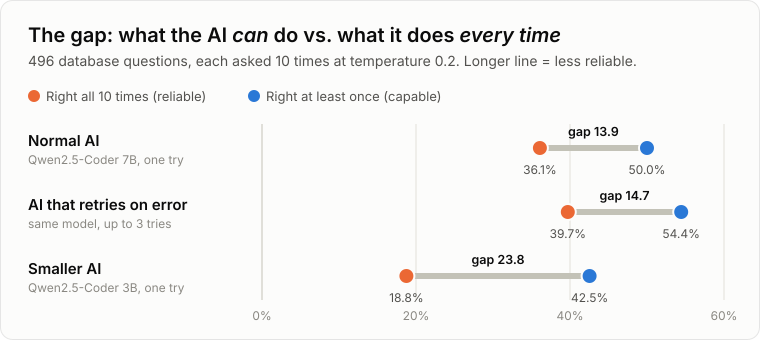
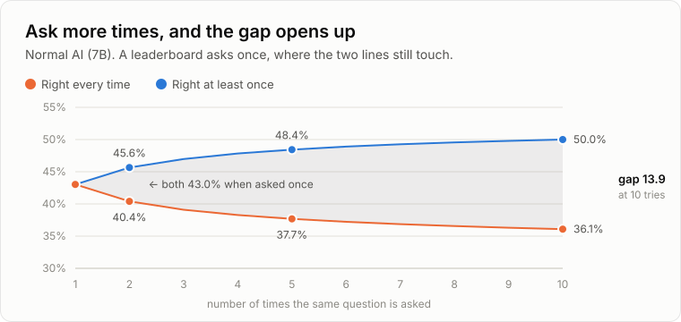
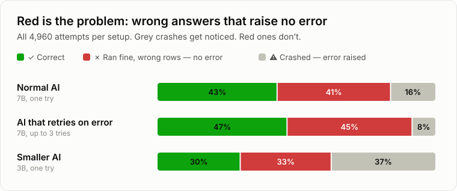

# Ask an AI the same question twice. Do you get the same right answer?

[](https://github.com/MohanVishe/nl2sql-reliability/actions/workflows/ci.yml)


[](LICENSE)

AI can turn a plain-English question — *"which customers spent the most last month?"* — into
**SQL**, the language databases understand. Most leaderboards score this by asking each
question **once**. But AI sampled with any randomness can give a different answer when you ask
again.

So I asked every question **ten times**. Here are the ten tries on one real question (the one
explained [below](#one-character-half-the-time)):

> ✅ ✅ ✅ ❌ ❌ ✅ ❌ ✅ ❌ ❌ &nbsp; *(5 right out of 10)*

A leaderboard sees only the first try, and would score this question as solved.

<p align="center"></p>

**The blue dot is the flattering number** — a question counts as solved if the AI got it right
even once. **The orange dot is what you can actually rely on.** The line between them is questions
the AI gets right *only sometimes*: they can pass your testing, then fail later with no warning.

Every number here is for sampling at **temperature 0.2**, a common low setting (the reason is
[below](#how-i-tested-it)).

---

## One try hides the problem

<p align="center"></p>

Asked once, the two lines are the same number — that is all a leaderboard can see. Each extra
try gives the AI another chance to get lucky (blue goes up) and another chance to slip (orange
goes down). **Most of the gap has opened by the third try** (7.9 of the 13.9 points). Ten tries
is itself a floor: asked more often, the orange line can only go lower.

---

## One character, half the time

A real question from the test: *"What's the French name of this card?"*

The database has an English table (`T1`) and a translations table (`T2`). Across ten identical
tries, the AI wrote this five times:

```sql
SELECT T2.name ...   -- ✅ French name, correct
```

and this the other five:

```sql
SELECT T1.name ...   -- ❌ English name, wrong
```

Same prompt. One character different. **The wrong one runs perfectly** and returns a
reasonable-looking answer. Nothing crashes, nothing warns you. Ask once, like a leaderboard does,
and it's a coin flip whether this question gets scored right or wrong.

---

## The worst mistakes don't look like mistakes

<p align="center"></p>

A crash is easy — your code catches the error. **The red bars are the real problem**: the
query runs fine and returns rows that don't match the reference answer. For the normal AI, those
silent mistakes outnumber the crashes more than **2 to 1** (2,026 to 800).

---

## I tried the two obvious fixes. Neither closed the gap.

**🔁 Let the AI fix its own mistakes.** When a query crashed, I showed the AI the error and let it
try again, up to three times. That's what most "AI agents" do.

→ Both scores went up a little (+4.4 and +3.6 points). **But there was no detectable change in
the gap** (13.9 → 14.7: +0.8 points, 95% interval −2.2 to +3.8). The retry only kicks in when
something *crashes*, so it never sees the silent mistakes. Even on the crashes it could see, it
turned fewer than **1 in 5** into a right answer (18%); counting every wrong answer, it fixed
about **1 in 20**. And some crashes it "fixed" just became silent wrong answers instead.

**📉 Use a smaller, cheaper AI.** Same family and the same 4-bit compression, half the size.

→ It lost **7.5 points** on the flattering score but **17.3 points** on reliability — more than
twice as much. **The gap rose by 9.9 points** (13.9 → 23.8; 95% interval +5.0 to +14.7), to
1.7 times the 7B's. Put another way: of the questions each model could answer at least once, the
7B got **72%** right on all ten tries, the 3B only **44%**. And on my machine it wasn't even
faster.

> **The flattering score makes the smaller model look a bit worse. On reliability, it's about
> half as good.**

---

## What this means if you build with AI

- **Test every question more than once.** One passing run proves very little.
- **Don't rely on error handling.** For the main model, most mistakes never raised an error.
- **Test on your own database.** Across databases the gap ran from 0 to 23 points for the 7B,
  and from 10 to 31 for the 3B.
- **Don't pick a smaller model from its benchmark score alone.** The score hides how much
  consistency you're giving up.

---

## How I tested it

**498 questions (496 scored) → ask the AI 10 times each → run every query on the real database →
check the rows that come back**

- **Three setups:** a 7B model, the same model with retries, and a smaller 3B model. (*7B* means
  7 billion *parameters* — the internal numbers a model learns. More parameters usually means a
  more capable, but slower and more memory-hungry, model.)
- **Free, open models** ([Qwen2.5-Coder](https://github.com/QwenLM/Qwen2.5-Coder)) running on my
  own computer. Big hosted models like GPT or Claude weren't part of this round; the same
  harness can test them.
- **14,880 scored generations** (14,940 records; 2 questions excluded because their reference
  query takes longer than the 30-second limit), all run locally on one desktop GPU. **Cost: $0.**
- **An answer key corrected by experts.** The popular BIRD test set has errors in about half its
  answer key, so I used [Arcwise-Plat-SQL](https://github.com/uiuc-kang-lab/text_to_sql_benchmarks),
  where database experts rewrote the reference SQL. This version corrects the SQL only and keeps
  the original questions' ambiguities, so part of the flakiness may be a model switching between
  two defensible readings. Each question comes with BIRD's hint text (its standard "evidence"
  setting).
- **No AI grades the AI.** A query counts as correct only if it returns the right rows from the
  real database. The scorer is stricter than BIRD's official one (it keeps duplicate rows and
  checks order when the reference sorts). Scored BIRD's way instead, every conclusion holds: see
  the [robustness check](docs/METHOD.md#robustness-bird-official-scoring).
- **Settings:** randomness ("temperature") at a low **0.2**. This is a design choice: the study
  measures how much a *sampled* model varies, and 0.2 is a common low setting for writing SQL.
  Temperature 0 (always pick the likeliest word) is often assumed to give identical answers every
  time; that was not measured here, and it is the next experiment. Each reply can be up to 512
  tokens (a single query needs about 50). Reasons for every setting are in
  [EXPLAINED §6](docs/EXPLAINED.md#the-settings-and-why-we-picked-them) and
  [METHOD](docs/METHOD.md#settings-and-why).

## Can you trust the numbers?

- **Every single attempt is published** in [`results/final/`](results/final/) — the AI's raw
  reply, the query, and the verdict. You can recompute every number here without running a model.
- **Two built-in math checks** confirm the scoring is right — both pass for all three setups.
- **Every change is tested for luck.** Could a difference just be chance — a few easy questions
  landing on one side? I resampled the questions with replacement 10,000 times and checked
  whether the difference survives. The score changes above all do; the only one that doesn't is
  the retry loop's small gap change, which is why it's reported as "no detectable change".
- **285 automated tests.** 269 run in CI on Python 3.11, 3.12 and 3.13 on every push; the 16
  that need the BIRD databases or the internet run locally.

## Limitations, and what's next

- **One temperature.** Everything is measured at 0.2. Next: a temperature-0 arm on the 7B, to
  measure how deterministic greedy decoding really is on a local GPU.
- **The answer key keeps the questions' ambiguities.** Next: rerun the 7B on Arcwise-Plat, the
  fully corrected release of the same 498 questions, to see how much of the gap is ambiguity.
- **Size and compression move together.** Both models are 4-bit, which may cost a 3B more than a
  7B. Next: the 3B at 8-bit, and a current-generation open model that fits 8 GB.
- **Attempts are not replayable one by one.** No decode seed was set. Next runs pass the run
  index as the seed, which keeps the ten tries different and makes each one repeatable.

---

## Read more

| If you want… | Read |
|---|---|
| The whole story, no background needed | **[docs/EXPLAINED.md](docs/EXPLAINED.md)** |
| The technical design, scoring rules and full tables | [docs/METHOD.md](docs/METHOD.md) |
| Exact settings, model versions, dates and timings for each run | [docs/RUN-LOG.md](docs/RUN-LOG.md) |
| A word you didn't recognise | [the glossary](docs/EXPLAINED.md#14-glossary) |

## Run it yourself

Needs Python 3.11+, [uv](https://docs.astral.sh/uv/) and [Ollama](https://ollama.com). Free, runs
on a normal gaming GPU.

Recompute every published number, no model or database needed:

```bash
uv sync --locked --extra dev
uv run python scripts/report.py          # each setup on its own, from results/final/
uv run python scripts/compare_arms.py --baseline local-7b-single   # setups against each other
```

Run a setup yourself:

```bash
uv run python scripts/fetch_databases.py      # 346 MB, one time; checked against pinned hashes
ollama pull qwen2.5-coder:7b
uv run python scripts/run_arm.py --arm local-7b-single --k 10
uv run python scripts/report.py results/local-7b-single.jsonl
```

Full reproduction steps for all three setups are in [docs/METHOD.md](docs/METHOD.md#reproduce).

---

## Credits and licences

- Code: MIT (this repo).
- [Arcwise-Plat-SQL](https://github.com/uiuc-kang-lab/text_to_sql_benchmarks) (Jin et al., VLDB
  2026, [arXiv:2601.08778](https://arxiv.org/abs/2601.08778)): CC BY-SA 4.0. Downloaded when you
  run the project, pinned to upstream commit `b83d8a8`, not stored here.
- [BIRD](https://bird-bench.github.io/) dev databases (Li et al., NeurIPS 2023,
  [arXiv:2305.03111](https://arxiv.org/abs/2305.03111)): CC BY-SA 4.0. Downloaded, not stored.
- Qwen2.5-Coder-7B-Instruct: Apache 2.0. Qwen2.5-Coder-3B-Instruct: Qwen Research License
  (research use; check it before any commercial use).

To cite this study, see [`CITATION.cff`](CITATION.cff).
